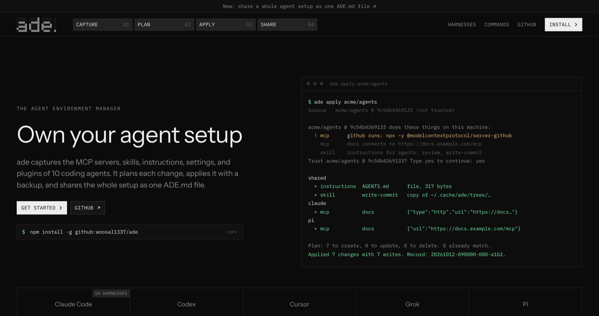
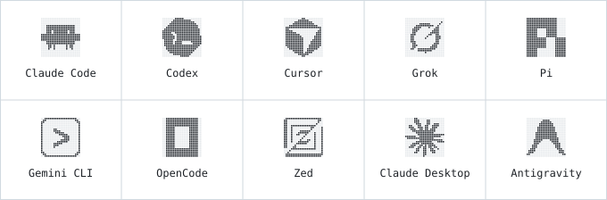
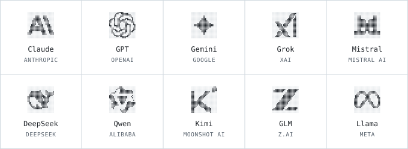

<h1 align="center">
  <picture>
    <source media="(prefers-color-scheme: dark)" srcset="docs/assets/ade-logo-dark.svg">
    
  </picture>
</h1>

**Own your agent setup.** ade captures the MCP servers, skills, instructions, settings, and plugins of 10 coding agents into one profile. Share the whole setup as one `ADE.md` file, and import any shared setup 1:1. ade plans each change and applies it with a backup.

[](https://github.com/woosal1337/ade/actions/workflows/checks.yml)


[Install](#install) · [Quick start](#quick-start) · [Share a setup](#share-a-setup) · [Harnesses](#supported-harnesses) · [Models](#models) · [Commands](#commands) · [Docs](#documentation)



## Why ade

| Problem | What ade does |
|---|---|
| Each agent keeps its own config format in its own folder | One profile writes the native format of each agent |
| A setup drifts between your machines | `ade plan` and `ade status` show each difference before a write |
| A shared setup is a list of manual steps | `ADE.md` holds the whole setup, and `ade apply <owner>/<repo>` copies it 1:1 |
| A config change is hard to undo | Each apply keeps backups, and `ade revert` restores them |

ade changes only the entries that the profile declares: one server, one key, one skill. Every other key in a config file stays as it is.

## Install

ade needs Node.js 22 or later and Git.

| Platform | Command |
|---|---|
| macOS and Linux | `curl -fsSL https://raw.githubusercontent.com/woosal1337/ade/main/scripts/install.sh \| sh` |
| Windows (PowerShell) | `irm https://raw.githubusercontent.com/woosal1337/ade/main/scripts/install.ps1 \| iex` |
| npm | `npm install -g "$(npm pack github:woosal1337/ade \| tail -1)"` |

Each command builds a package file from the GitHub source, then installs it. Do not use `npm install -g github:woosal1337/ade`. In a global install, npm runs the build step of a Git package without its build tools, so the build fails ([npm/cli#8440](https://github.com/npm/cli/issues/8440)).

To install ade and set up a machine from a shared setup in one step, give the source to the script:

| Platform | Command |
|---|---|
| macOS and Linux | `curl -fsSL https://raw.githubusercontent.com/woosal1337/ade/main/scripts/install.sh \| sh -s -- <owner>/<repo>` |
| Windows (PowerShell) | `$env:ADE_SOURCE = "<owner>/<repo>"; irm https://raw.githubusercontent.com/woosal1337/ade/main/scripts/install.ps1 \| iex` |

The scripts show the plan and ask before the apply.

## Quick start

1. Capture the setup of this machine into a profile folder:

   ```bash
   ade capture --out ~/agent-profile
   ```

2. Show what ade would change. A plan never writes:

   ```bash
   ade plan --profile ~/agent-profile
   ```

3. Apply the profile to a machine. ade asks before it writes:

   ```bash
   ade apply --profile ~/agent-profile
   ```

4. Undo the last apply:

   ```bash
   ade revert
   ```

Run `ade inventory` to see each file of each agent on your machine, and which files ade syncs.

## Share a setup

1. Write one Markdown file with the whole setup:

   ```bash
   ade share --profile ~/agent-profile --repo you/agents
   ```

2. Read the file, then commit `ADE.md` to the repository.
3. Others import it, then plan and apply it. `ade import` asks for trust first:

   ```bash
   ade import you/agents
   ade plan
   ade apply
   ```

   To skip the editable copy, run `ade apply you/agents`. It fetches, plans, and applies in one command.

GitHub shows `ADE.md` as a normal page: the install steps, what the setup runs and writes, the secret names, and every file. Each file has a SHA-256 hash, so `ade verify ADE.md` fails on a hand edit. Use it in CI:

```yaml
- run: npx -y github:woosal1337/ade verify ADE.md
```

A source can be a local folder, an `ADE.md` file, `owner/repo[/subfolder][@ref]` on GitHub, or any Git URL. Read [the ADE.md standard](docs/ade-md.md) and [the sources guide](docs/sources.md).

## Supported harnesses

<picture>
  <source media="(prefers-color-scheme: dark)" srcset="docs/assets/harnesses-dark.svg">
  
</picture>

| Harness | Instructions | MCP servers | Skills | Settings | Plugins | Also synced |
|---|:---:|:---:|:---:|:---:|:---:|---|
| Claude Code | ● | ● | ● | ● | ● | agents, commands, hooks, output styles, local MCP servers |
| Codex | ● | ● | ● | ● | ● | prompts, rules, agents, hooks |
| Cursor | | ● | ● | ● | ● | CLI and IDE settings, hooks, agents, commands, rules |
| Grok | ● | ● | ● | ● | ● | hooks, agents, commands, local plugins |
| Pi | ● | ● | ● | ● | ● | packages, extensions, prompts, themes, package patches |
| Gemini CLI | ● | ● | ● | ● | ● | agents, commands, policies |
| OpenCode | ● | ● | ● | ● | ◐ | agents, commands, modes, tools, themes |
| Zed | | ● | | ● | ● | key map, tasks, snippets, themes |
| Claude Desktop | | ◐ | | ● | ◐ | desktop extensions |
| Antigravity | ● | ● | ● | ● | | hooks, global workflows |

● synced. ◐ partly: Claude Desktop takes only stdio MCP servers, and OpenCode and Claude Desktop plugins sync as settings or files. Cursor keeps user rules in the Cursor account, so no file exists to sync.

ade never syncs sign-ins, tokens, sessions, history, or caches. Read [the harness support list](docs/harnesses.md) for each file of each harness.

## Models

Each harness keeps its own model. ade syncs that setting with the rest of the setup. ade does not change model names and does not sync sign-ins.

<picture>
  <source media="(prefers-color-scheme: dark)" srcset="docs/assets/models-dark.svg">
  
</picture>

| Harness | File | Key |
|---|---|---|
| Claude Code | `~/.claude/settings.json` | `model` |
| Codex | `~/.codex/config.toml` | `model` |
| Cursor | `~/.cursor/cli-config.json` | `model.modelId` |
| Grok | `~/.grok/config.toml` | `models.default` |
| Pi | `~/.pi/agent/settings.json` | `defaultProvider`, `defaultModel` |
| Gemini CLI | `~/.gemini/settings.json` | `model.name` |
| OpenCode | `~/.config/opencode/opencode.json` | `model` |
| Zed | `~/.config/zed/settings.json` | `agent.default_model` |
| Antigravity | `~/.gemini/antigravity-cli/settings.json` | `model` |

## How it works

```text
machine ──capture──▶ profile ──plan──▶ changes ──apply──▶ machine
                        │                                    │
                        └──share──▶ ADE.md        revert ◀───┘
```

1. A profile is a folder with `ade.json`, the instructions, the skills, and the extra files.
2. The plan compares three states for each entry: the profile, the machine, and the last apply.
3. Apply writes atomic changes with backups, and records a content hash for each entry.
4. A later plan uses the hashes to find drift: a change made outside ade.

Read [the architecture](docs/architecture.md) for the modules and the data flow.

## Commands

| Command | Use |
|---|---|
| `ade capture`, `ade init` | Make a profile from this machine, or an empty profile |
| `ade add`, `ade remove`, `ade set`, `ade unset`, `ade list` | Edit and read the profile |
| `ade plan`, `ade apply`, `ade status` | Compare, apply, and show drift |
| `ade revert`, `ade history` | Undo an apply, list the apply records |
| `ade inventory`, `ade harnesses`, `ade doctor` | List harness files, show harness paths, check the profile |
| `ade share`, `ade verify`, `ade import` | Write and check `ADE.md`, import a shared setup into a profile |
| `ade use`, `ade trust`, `ade update` | Set the default source, trust a Git source or a shared file, lock Git skills |
| `ade remote <host> <command>` | Run plan, apply, status, revert, or capture on another machine over SSH |

Every command takes `--json`. Run `ade help <command>` for its options.

## Safety

- **Plan first.** `ade apply` shows the plan and asks before it writes. `--yes` skips the question.
- **Trust.** A Git source or a shared `ADE.md` file needs your trust before ade imports or applies it. ade lists the programs it runs, the files it writes, and the secrets it reads. A change in any entry that ade writes or runs needs trust again.
- **Secrets.** A profile holds `${secret:NAME}` references, never values. ade reads the values at apply time from the environment, a file, a command, or the macOS Keychain. `ade share` refuses values that look like tokens.
- **Backups.** Each apply keeps backups and a record. A failed apply rolls back. `ade revert` restores one apply.
- **Drift.** ade stops when an entry changed outside ade. `--force` overwrites it.

Read [the security model](docs/security.md) for the trust gate and the secret handling. Report a security problem through [SECURITY.md](SECURITY.md), not in a public issue.

## Remote machines

```bash
ade remote devbox plan --profile ~/agent-profile
ade remote devbox apply --profile ~/agent-profile
```

ade sends its engine and the profile over SSH. The other machine needs only Node.js 22. Read [the remote guide](docs/remote.md).

## SDK

```ts
import { apply, createContext, plan, resolveProfile } from "@woosal1337/ade";

const ctx = createContext();
const { loaded } = await resolveProfile("you/agents", ctx);
const preview = await plan(loaded, ctx);
await apply(loaded, ctx, { expectedFingerprint: preview.fingerprint });
```

The CLI uses the same engine. Read [the SDK guide](docs/sdk.md).

## Documentation

| Document | Content |
|---|---|
| [ADE.md standard](docs/ade-md.md) | The shared file format |
| [Harness support](docs/harnesses.md) | Each file of each harness |
| [Profile reference](docs/profile.md) | The `ade.json` format |
| [Sources](docs/sources.md) | Git sources, trust, and publication |
| [Remote machines](docs/remote.md) | Commands over SSH |
| [SDK](docs/sdk.md) | The TypeScript API |
| [Security model](docs/security.md) | The trust gate, the secret handling, and the limits |
| [Changelog](CHANGELOG.md) | The changes in each version |
| [Architecture](docs/architecture.md) | Modules, data flow, and storage |
| [Runbook](docs/runbook.md) | Moves, recovery, and publication steps |
| [Decisions](docs/decisions) | The design decisions and their reasons |

## Status

Version 0.1.0. ade is not on npm yet. Known limits:

- A JSON write removes the comments of the file. The plan warns before the write.
- A shared setup applies to every harness that it names, also on a machine without that harness.
- A setup has no rules for each operating system. A shell hook from macOS also goes to Windows.

## Development

```bash
npm ci
npm ci --prefix site
python3 tools/quality.py hooks-install
python3 tools/quality.py check
```

| Path | Content |
|---|---|
| `src/` | The engine, the CLI, and the SDK |
| `test/` | Tests that run in scratch home folders |
| `site/` | The landing page: Next.js, Tailwind CSS, and motion |
| `scripts/` | The install scripts |
| `tools/build-logo.mjs` | Writes the favicon, the README logo, and the logo strips from `site/app/glyphs.ts` and `site/app/brands.ts` |
| `examples/` | A sample profile folder and a sample `ADE.md` |
| `docs/` | Guides and decision records |

Run the landing page with `npm --prefix site run dev`. Read [CONTRIBUTING.md](CONTRIBUTING.md) and [the quality gates](docs/quality.md) before a change.

## License

The license is not chosen yet.

Product names and logos belong to their owners. ade has no link to these companies. Read [THIRD_PARTY.md](THIRD_PARTY.md) for the logo sources, their licenses, and the font licenses.
